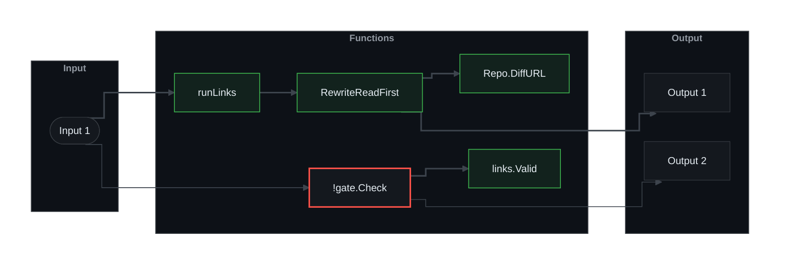

<!-- pr-brief:begin v1 style=ste+iceberg theme=github-dark -->
## Brief
Reviewers had to look for the files in the Read these first table. Each file is now a link, so they open it from the description. The link follows the PR to its latest commit, never to one commit. A new command writes the links, and the gate rejects a file with no link or a stale one. The skill adds the links after it creates the PR.

## Change map
### Flow 1: Input 1 -> a description gets linked files, and the gate checks them

**Legend:** 🟩 added · 🔴 risk (! and a thick red border)

| Ref | What | Detail |
|---|---|---|
| Input 1 | `pr-brief links` and `pr-brief gate` | The skill runs `links` on a description. The gate checks the result. |
| Output 1 | The description with linked files | Before the PR exists, a file links to the branch. After it, a file links to its diff in the PR. |
| Output 2 | The gate findings | A row fails when it has no link or links to another file. It also fails when the link shows an older state: one commit, a range of commits or an older iteration. |

## Review guide
**What changed**:
- `runLinks`: reads a description and the remote, and prints the description with linked files.
- `RewriteReadFirst`: finds the Read-these-first table and links each row.
- `Repo.DiffURL`: builds the link to a file's diff in a PR, for GitHub and Azure DevOps.
- `links.Valid`: checks that a link points at its file and shows the whole PR, not one commit or a range.
- `gate.Check`: fails a row with no link, a wrong link, or a link to an older state.

**Read these first**
| File | Why it is delicate | What to check |
|---|---|---|
| [`internal/links/links.go`](https://github.com/gagoar/pr-brief/pull/14/files#diff-af6d98b39a58930341c268de21116a1df94ea9975c38c62ec43f0f40e7751198) | It builds both host formats and decides which links are valid. | Check the Azure DevOps URLs. No live organisation has tested them. |
| [`internal/gate/check.go`](https://github.com/gagoar/pr-brief/pull/14/files#diff-8e8ae94c60bdf527c9112cbfbd3678c9ea2e9ded559a521610498ba6dffe34b5) | A wrong rule here blocks every PR. | Check the three messages, and that a link to the branch still passes. |
| [`cmd/pr-brief/links.go`](https://github.com/gagoar/pr-brief/pull/14/files#diff-de4075d4f9041056ae98204bb015801f2e4d71d7976f794f1c141d3e89857f00) | It reads the remote and picks the form of the link. | Check the order: `--pr` first, then `--branch`, then the current branch. |
| [`skills/pr-brief/SKILL.md`](https://github.com/gagoar/pr-brief/pull/14/files#diff-409dc0398e959a0fcf5b9fc22de1837cf33cd68ec753b1b252a4a99395c29bc5) | The agent follows it to link, to create the PR and to upgrade the links. | Check step 7 and step 8. |

**Review order**: Start at `runLinks`, then follow the arrows to `Repo.DiffURL`.

Other changed files (23) · tests: 3 · docs: 12 · generated: 0

- `.claude-plugin/` (1 file)
- `.github/` (1 file)
- `./` (1 file)
- `bin/` (5 files)
- `cmd/pr-brief/` (2 files)
- `docs/` (7 files)
- `internal/gate/` (1 file)
- `internal/host/` (1 file)
- `internal/initfiles/templates/` (1 file)
- `internal/links/` (1 file)
- `skills/pr-brief/references/` (2 files)

<!-- pr-brief:end -->

